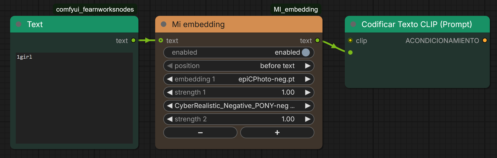

# MI_embedding

A small ComfyUI custom node (shown as **Mi embedding**) to pick textual-inversion embeddings from a dropdown, set the strength of each one and switch the whole thing on or off, all without typing `embedding:name` by hand.



## Features

- **Dropdown of your embeddings**: lists every file ComfyUI sees in the `embeddings` folder (including folders added through `extra_model_paths.yaml`).
- **Strength per embedding**: from -10 to 10, default 1.0.
- **Enable / disable toggle**: when disabled, the node passes the incoming text through untouched, so you can compare with and without embeddings without rewiring.
- **Several embeddings in one node**: use the `+` and `-` buttons to add or remove rows (up to 8).
- **Before / after text**: choose whether the embeddings go before or after the incoming prompt.
- **Subgraph friendly**: every row uses standard widgets, so they can be promoted to a subgraph.

## Installation

Clone or copy this folder into your ComfyUI `custom_nodes` directory and restart ComfyUI:

```
ComfyUI/custom_nodes/MI_embedding
```

No extra dependencies are needed.

## Usage

1. Add the node: double-click the canvas and search for **Mi embedding** (category `MI`).
2. Optionally connect a `STRING` prompt to the `text` input.
3. Pick an embedding and set its strength. Use `+` / `-` to add or remove rows.
4. Connect the `text` output to the text input of a `CLIPTextEncode` node (convert the widget to an input first).

### Output examples

| Rows | Text in | Position | Output |
|------|---------|----------|--------|
| `epiCPhoto.pt`, 1.0 | `1girl` | before text | `embedding:epiCPhoto, 1girl` |
| `epiCPhoto.pt`, 1.3 | `1girl` | after text | `1girl, (embedding:epiCPhoto:1.3)` |
| `epiCPhoto.pt`, 0.8 | none | before text | `(embedding:epiCPhoto:0.8)` |
| `epiCPhoto.pt`, 1.3 | `1girl` | disabled | `1girl` |

Rows set to `(none)` are ignored.

## Notes

- The embedding list is read when ComfyUI starts. Restart ComfyUI after adding new embedding files.
- Embeddings must match the model family you are using (SD1.5, SDXL, ...), as with any textual inversion.

## Files

- `__init__.py`: node definition and prompt building.
- `js/mi_embedding.js`: frontend extension (row show/hide, `+` / `-` buttons).

## License

[MIT](LICENSE): free to use, modify and distribute.
